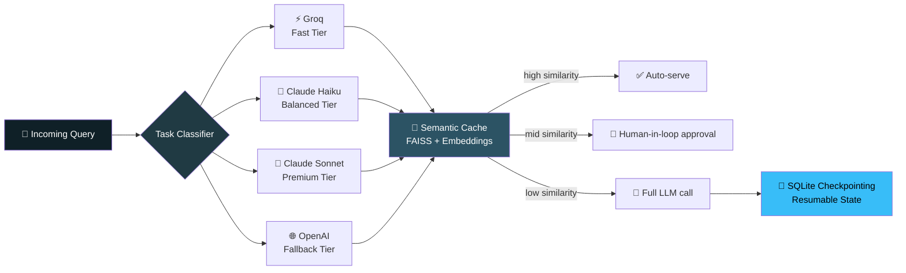

 

## 👋 About Me

- 🎓 B.Sc. Data Science, Thakur College of Science and Commerce — **CGPA 8.12** (2023–2026)
- 🧠 I build **end-to-end ML & AI systems** — RAG pipelines, multi-agent LLM orchestration, and production deployment
- 🔐 Focused on **privacy-preserving, cost-aware AI architecture** — systems that are correct by design, not just plausible-sounding
- ⚙️ Full MLOps stack: **Docker → AWS/Railway → GitHub Actions CI/CD**
- 📊 Strong foundations in classic ML, NLP, and data visualization alongside modern LLM tooling
- 💬 Ask me about: LangGraph orchestration, RAG evaluation harnesses, or deterministic-vs-LLM system design

 

## 🧬 Core Stack

 

 

 

## 🚀 Featured Projects

### 🧭 TieredFlow — Cost/Latency-Aware Multi-Agent LLM Orchestrator

Multi-agent **LangGraph** pipeline routing queries across four cost/latency tiers under real-time budget constraints, with automatic downgrade when budget runs low. Semantic caching (FAISS + Sentence-Transformers) cuts redundant LLM calls via a tiered transparency model — auto-serve, human-in-the-loop, or full bypass depending on similarity. Includes 5 integrated tools with fallback chains, confidence scoring, a multi-case evaluation harness, and a live-routing Streamlit UI with one-click CSV export.

`LangGraph` `LangChain` `LangSmith` `Anthropic/OpenAI/Groq` `FAISS` `SQLite` `Streamlit`

---

### 🔒 Tax Filing RAG Assistant — Privacy-First AI System

Privacy-by-design system aligned with India's **DPDP Act**: per-session ChromaDB collections are physically incapable of persisting beyond session end, enforced at the runtime level with a 20-minute TTL sweep. Tax math (slab rates, surcharge, cess, 87A rebate, HRA exemption) is computed in **pure deterministic Python — never delegated to the LLM** — achieving 100% regime recommendation accuracy across synthetic personas from ₹6L–₹50L income. A LangSmith redaction layer strips PII before traces leave the process.

| Metric | Result |
|---|---|
| Field extraction accuracy | **100%** (130/130 checks) |
| Regime recommendation accuracy | **100%** |
| RAG faithfulness / relevance | **89.3%** |

Deployed as independent FastAPI + Streamlit services on Railway via Docker, gated by threshold-based GitHub Actions CI on every push.

`FastAPI` `Streamlit` `ChromaDB` `Claude Haiku` `LangSmith` `Docker` `Railway`

---

### 🚗 Vehicle Insurance Cross-Sell Prediction — MLOps Pipeline

Production-grade MLOps pipeline: MongoDB Atlas ingestion → schema validation → transformation → training → evaluation, with automated retraining support. Containerized with Docker and deployed on AWS EC2; model artifacts versioned on S3 for reproducible runs and rollback. CI/CD via GitHub Actions + AWS ECR enables zero-touch redeployment on every push to main. Flask prediction API with a web UI for real-time inference.

`Scikit-learn` `MongoDB` `Docker` `AWS EC2/ECR/S3` `GitHub Actions` `Flask`

 

## 📊 GitHub Stats

   
 
  
 
  
 
  

  

